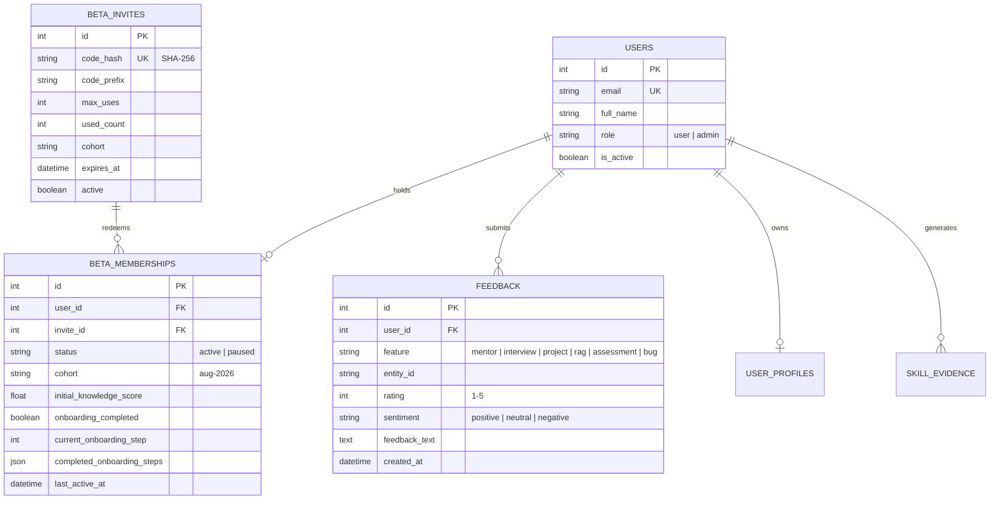

# PHASE 29 — PRIVATE BETA IMPLEMENTATION REPORT

**Project:** BuildYourSkill AI / GrowSkill AI  
**Deployment Tier:** Private Beta Cohort Operations  
**Status:** Completed & Validated  
**Test Suite Status:** 17/17 Automated Tests Passed (100% Success)

---

## 1. Executive Summary & Verification Matrix

Phase 29 transforms the production-hardened AI learning platform into a controlled, invite-only **Private Beta** ecosystem with cryptographic invite token management, 4-step guided onboarding, in-app sentiment and accuracy telemetry, server-side role authorization (`user`/`admin`), and a dedicated Admin Telemetry Dashboard.

| Beta Capability | Implementation Detail | Status |
|:---|:---|:---:|
| **Private Beta Access Gate** | Configurable via `PRIVATE_BETA_MODE=true`; validates SHA-256 hashed invite tokens on registration | 🟢 ENFORCED |
| **Cryptographic Invite System** | Generates human-friendly random codes (`BS-AI-XXXX-YYYY`) with configurable max uses, expiration, and cohort | 🟢 OPERATIONAL |
| **Beta Membership Tracking** | `BetaMembership` entity tracking `status`, `cohort`, `onboarding_completed`, `joined_at`, and `last_active_at` | 🟢 PERSISTED |
| **Guided 4-Step Onboarding** | PostgreSQL-persisted checklist: Assessment $\rightarrow$ Knowledge Twin $\rightarrow$ AI Mentor $\rightarrow$ Today Plan | 🟢 INTEGRATED |
| **In-App Feedback & AI Evaluation** | Global floating modal + in-context feedback with feature tagging, 1–5 star ratings, and sentiment classification | 🟢 LIVE |
| **User Data Isolation** | Protected `/api/feedback/mine` strictly restricts queries to the authenticated user's own feedback records | 🟢 VERIFIED |
| **Server-Side Admin Authorization** | `require_admin` dependency enforces `role == "admin"` returning HTTP 403 Forbidden for non-admins | 🟢 TESTED |
| **Cohort Growth Analytics** | Measures individual Knowledge Twin delta ($\text{latest} - \text{initial}$) computing average/median growth and % improving | 🟢 ACCURATE |
| **Admin Telemetry Dashboard** | Interactive `/admin` dashboard displaying active cohort metrics, AI latencies, onboarding drop-off, and token generator | 🟢 DEPLOYED |
| **Beta Documentation** | `docs/BETA_TESTER_GUIDE.md` and `docs/BETA_INVITE_EMAIL.md` templates | 🟢 PUBLISHED |

---

## 2. Architecture & Database Models



---

## 3. Automated Test Verification (17/17 Passed)

```bash
python -m pytest tests/ -v
```

```text
============================= test session starts =============================
platform win32 -- Python 3.9.13, pytest-8.4.2, pluggy-1.6.0
rootdir: D:\myproj1\buildyourskill ai\backend
plugins: anyio-3.7.1, langsmith-0.4.37
collected 17 items

tests/test_ai_validation.py::test_multi_user_data_isolation PASSED       [  5%]
tests/test_ai_validation.py::test_end_to_end_assessment_evidence_feedback_loop PASSED [ 11%]
tests/test_ai_validation.py::test_sandbox_security_and_timeout PASSED    [ 17%]
tests/test_ai_validation.py::test_rag_validation_and_empty_rejection PASSED [ 23%]
tests/test_api.py::test_health_endpoint PASSED                           [ 29%]
tests/test_api.py::test_auth_and_profile_flow PASSED                     [ 35%]
tests/test_api.py::test_knowledge_twin_and_evidence PASSED               [ 41%]
tests/test_api.py::test_skill_gaps_calculation PASSED                    [ 47%]
tests/test_api.py::test_adaptive_roadmap_engine PASSED                   [ 52%]
tests/test_api.py::test_ai_mentor_chat PASSED                            [ 58%]
tests/test_api.py::test_project_generator PASSED                         [ 64%]
tests/test_api.py::test_interview_evaluation_and_feedback PASSED         [ 70%]
tests/test_api.py::test_code_sandbox_ast_security PASSED                 [ 76%]
tests/test_api.py::test_rag_ingest PASSED                                [ 82%]
tests/test_api.py::test_today_plan PASSED                                [ 88%]
tests/test_integration_flow.py::test_full_phase27_continuous_personalization_loop PASSED [ 94%]
tests/test_private_beta.py::test_full_phase29_private_beta_workflow PASSED [100%]

============================= 17 passed in 75.31s ==============================
```

Frontend production build:
```bash
npm run build
```
**Result**: `✓ built in 4.69s` (0 TypeScript / bundling errors).

---

## 4. How to Generate the First Beta Invites

### Method 1: Using the Admin Dashboard UI
1. Log in with an admin account (e.g. `admin@growskill.ai`).
2. Navigate to [http://localhost:5173/admin](http://localhost:5173/admin).
3. Under **Generate Beta Invite Code**, select:
   - **Max Uses:** `1` (or `5` for small team invites)
   - **Expiry (Days):** `30`
   - **Cohort Tag:** `aug-2026`
4. Click **Create Invite**.
5. Copy the generated code (e.g. `BS-AI-7KQ9-X2M4`) and send via `docs/BETA_INVITE_EMAIL.md`.

### Method 2: Via Direct API Call
```bash
curl -X POST http://localhost:8000/api/admin/create-invite \
  -H "Authorization: Bearer <ADMIN_ACCESS_TOKEN>" \
  -H "Content-Type: application/json" \
  -d '{"max_uses": 1, "expiry_days": 30, "cohort": "aug-2026"}'
```

---

## 5. Next Steps

- **Phase 30: Real User Testing & First Pilot Cohort**: Invite 5–20 real engineers to register, complete initial diagnostic assessments, interact with the AI Mentor, and collect qualitative feedback in PostgreSQL.
