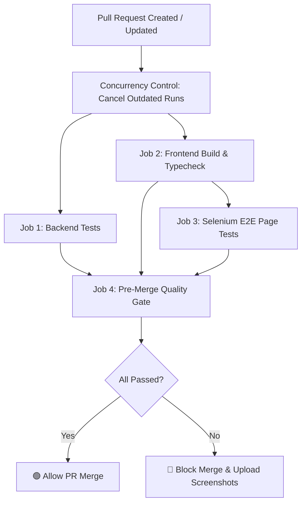

# Pre-Merge CI/CD Automation Guide

This document details the GitHub Actions Pre-Merge CI/CD Pipeline implemented in `.github/workflows/ci.yml` for the **GrowSkill AI** repository.

---

## 1. Overview of Pre-Merge Quality Gates

Every Pull Request targeting `main` or `master` triggers automated quality checks across both the backend and frontend. Merges can be blocked until all gates pass:



### The 4 Automated Jobs

1. **`backend-tests` (Backend Test Suite & Regression):**
   - Environment: Ubuntu Latest, Python 3.11 with pip caching.
   - Executes all 17 FastAPI regression tests (`test_api.py`, `test_ai_validation.py`, `test_integration_flow.py`, `test_private_beta.py`).
2. **`frontend-build` (Frontend Typecheck & Vite Build):**
   - Environment: Ubuntu Latest, Node.js 20 with npm caching.
   - Runs `tsc && vite build` to prevent TypeScript compilation errors or broken imports from reaching production.
3. **`e2e-selenium-tests` (Selenium 4 Browser Automation):**
   - Environment: Ubuntu Latest with Headless Chrome.
   - Builds frontend and launches backend & frontend background servers.
   - Waits for health endpoints (`/api/health` and `:5173`).
   - Runs all 44 test cases across all 18 pages.
   - Automatically saves and uploads full-resolution screenshot artifacts (`selenium-failure-screenshots`) on any failure.
4. **`pre-merge-gate` (Unified Status Check):**
   - Aggregates status across jobs to provide a single, clean gate for GitHub branch protection settings.

---

## 2. Setting Up GitHub Branch Protection (Enforce Pre-Merge Passing)

To require that all pre-merge tests pass before anyone can merge code into `main`:

1. On your GitHub repository page, navigate to **Settings** $\rightarrow$ **Branches**.
2. Click **Add branch ruleset** or **Add branch protection rule**.
3. Under **Branch name pattern**, enter: `main` (and optionally `master`).
4. Enable the following protections:
   - [x] **Require a pull request before merging**
   - [x] **Require status checks to pass before merging**
   - [x] **Require branches to be up to date before merging**
5. In the search box under *Status checks that are required*, search for and select:
   - `Pre-Merge Quality Gate` (or individual jobs `Backend Test Suite & Regression`, `Frontend TypeScript & Vite Build`, `Selenium E2E Page Tests (Headless Chrome)`).
6. Click **Save Changes**.

---

## 3. Concurrency & Performance Optimizations

- **Automatic Cancelation of Obsolete Runs:** If a developer pushes multiple commits in quick succession to the same PR, previous unfinished CI runs are automatically canceled (`cancel-in-progress: true`), preventing runner queue congestion.
- **Dependency Caching:** Uses GitHub Actions native caching for Python `pip` packages and Node `npm` modules to cut build times by over 60%.
- **Parallel Execution:** Backend tests and Frontend build jobs run in parallel to minimize total pipeline duration.

---

## 4. How to Run Pre-Merge Checks Locally

Before pushing a branch or opening a Pull Request, run the local pre-merge verification scripts:

### Step 1: Run Backend Tests
```bash
cd backend
python -m pytest tests/ -v
cd ..
```

### Step 2: Validate Frontend Build
```bash
cd frontend
npm run build
cd ..
```

### Step 3: Run Selenium E2E Tests
```bash
# Terminal 1: Start frontend
cd frontend && npm run dev

# Terminal 2: Run E2E tests
python tests_e2e/run_tests.py
```
